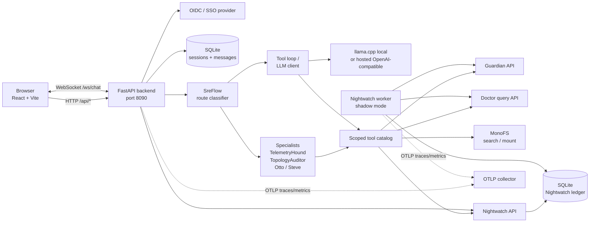

# Strata SRE Agent

Strata SRE Agent is the assistance plane of the Strata platform. It answers questions about the running platform, investigates incidents, and proposes changes that are only executed after explicit approval. A FastAPI backend exposes chat, session, agent, Nightwatch, proposal, auth, and read-only Guardian APIs; a React frontend provides chat, terminal, dashboard, Nightwatch, and settings views. The agent combines Doctor telemetry, Guardian topology, and MonoFS code search through scoped tool allowlists, with an optional background Nightwatch worker that observes alerts in shadow mode.

## Architecture



The backend runs as a single FastAPI application. Docker Compose also runs a llama.cpp server for the default local model and an nginx container that serves the built frontend and proxies `/api/` and `/ws/` to the backend. Nightwatch is not a separate Compose service; the same image is started with `uvicorn app.nightwatch.main:app` in its own partition.

## Components

| Component | Responsibility |
| --- | --- |
| Backend API (`backend/app/api`) | Chat over `POST /api/chat` and `WS /ws/chat`; session CRUD; agent status/models; settings; OIDC auth; Guardian read proxy; Nightwatch read proxy; proposal creation; health; generated media. |
| Agent orchestration (`agent/sre_flow.py`) | `SreFlow` classifies each turn into `mutate_infra`, `triage`, `crew_collab`, `code_fix`, or `general`, then runs the matching deterministic sequence. |
| Tool loop (`agent/loop.py`) | Parses JSON tool calls (and DeepSeek DSML markup), executes every call in a completion, enforces telemetry tool use, retries malformed calls with a GBNF grammar, and escalates to a fallback model when the loop stalls. |
| Personas and routing (`agent/personas.py`, `agent/router.py`) | Otto (SRE) and Steve (software engineering) personas. Auto routing uses explicit `@otto`/`@steve`, keyword votes, sticky follow-up handling, and a local-model classifier. |
| Specialists (`agent/specialists.py`) | Scoped mini tool loops with explicit allowlists: TelemetryHound, TopologyAuditor, OutageOtto synthesis, and SoftwareSteve. |
| Tool catalog (`agent/tools.py`) | 53 registered tools in `general`, `strata`, `guardian`, `doctor`, `nightwatch`, `monofs`, and `workspace` categories. Each skill declares its parameters, status text, and whether it mutates state. |
| LLM client (`llm/client.py`, `llm/presets.py`) | OpenAI-compatible chat completions with profiles `local`, `steve`, `fallback`, and `provider:<name>`. Optional llama.cpp grammar-constrained tool calls and hybrid escalation. |
| Nightwatch worker (`nightwatch/`) | Shadow-mode observer that polls Sentinel alerts, correlates incidents, collects evidence, records findings and observability improvements, and recommends but never executes actions. |
| Workspace sandbox (`agent/workspace.py`) | MonoFS FUSE mount at `/workspace` with a local overlay at `/data/monofs-overlay`. Provides confined read/list/write/diff and `monofs-session` commit/push. |
| Frontend (`frontend/src`) | React 19 + Vite + Tailwind. Pages: landing, chat, Guardian dashboard, Nightwatch, settings, and an embeddable Ask Strata drawer. |
| Telemetry (`telemetry/otel.py`) | OTLP gRPC trace and metric export for the API and the Nightwatch process, with FastAPI instrumentation. |

### Agent routes

`classify_route` makes routing deterministic:

- **general**: ordinary conversation. Uses the legacy single-agent loop restricted to 11 general tools.
- **triage**: operational questions. Runs TelemetryHound and TopologyAuditor concurrently, builds typed telemetry/topology reports, checks four-golden-signal coverage, and has Otto synthesize a strict JSON verdict. A deterministic fallback verdict is used if synthesis fails.
- **crew_collab**: operational and code signals in the same turn. Triage followed by Software Steve.
- **code_fix**: Steve only, in the MonoFS workspace.
- **mutate_infra**: reconcile, deploy, or push language. Registers an approval request and executes nothing until the user approves.

### Specialist tool scopes

| Specialist | Tools | Purpose |
| --- | --- | --- |
| TelemetryHound | 8 Doctor tools: metric names/labels/query, log search, LogQL schema/query, recent traces, trace detail | Collect logs, metrics, and traces. |
| TopologyAuditor | 7 tools: Guardian overview/partitions/detail/intent activity/asset describe, Doctor event analysis, LB Edge services | Establish deployment state, drift, and failing assets. |
| SoftwareSteve | 10 tools: MonoFS search/status, workspace status/list/read/write/diff, Guardian intent plan/partition validate, Doctor graph validate | Locate, edit, diff, and validate code or manifests. |
| OutageOtto synthesis | No tools | Reason only over specialist reports and return a typed verdict. |

## Runtime and configuration

Configuration is read from environment variables by `pydantic-settings`. Runtime overrides saved through `PUT /api/settings` are persisted to `/data/lagent_settings.json` and take precedence until restart. Secrets are masked by `GET /api/settings` and blank secret fields in a `PUT` do not overwrite stored values.

| Area | Variables | Notes |
| --- | --- | --- |
| Local model server | `MODEL_PRESET`, `MODEL_REPO`, `MODEL_FILE`, `CTX_SIZE`, `N_GPU_LAYERS`, `THREADS`, `PARALLEL`, `REASONING_FORMAT`, `EXTRA_ARGS` | Presets: `gemma4-e4b` (default), `qwen3.5-9b`, `qwen3.5-4b`, `custom`. Weights are downloaded by the `llm` container. |
| Primary LLM | `LLM_BASE_URL`, `LLM_MODEL`, `LLM_API_KEY` | Any OpenAI-compatible endpoint. Defaults to `http://llm:8080`. |
| Tool-call and hybrid behavior | `LLM_GRAMMAR_ENABLED`, `LLM_TOOL_GRAMMAR`, `LLM_REQUEST_EXTRA`, `LLM_HYBRID_ENABLED`, `LLM_HYBRID_AFTER_ROUNDS`, `LLM_MAX_TOOL_ROUNDS` | Grammar applies only to profiles that declare grammar support (local llama.cpp by default). Hybrid escalation uses the fallback profile. |
| Fallback and providers | `LLM_FALLBACK_BASE_URL`, `LLM_FALLBACK_MODEL`, `LLM_FALLBACK_API_KEY`, `LLM_FALLBACK_PROVIDER`, `LLM_PROVIDERS_JSON` | Named provider profiles are JSON objects and are selected with `provider:<name>`. |
| Steve engine | `STEVE_ENGINE`, `STEVE_LLM_BASE_URL`, `STEVE_LLM_MODEL`, `STEVE_LLM_API_KEY`, `AUTO_SWITCH_ENABLED` | Empty engine auto-detects OpenCode, then DeepSeek, then local. Otto always uses the local profile. |
| OpenCode | `OPENCODE_API_KEY`, `OPENCODE_SERVER_URL`, `OPENCODE_MODEL`, `OPENCODE_PROVIDER_ID`, `OPENCODE_SYSTEM_PROMPT` | Optional external coding engine for Steve. |
| Agent behavior | `AGENT_NAME`, `AGENT_SYSTEM_PROMPT`, `AGENT_FLOW_ENABLED`, `AUTO_PUSH_ENABLED` | `AGENT_FLOW_ENABLED=false` falls back to the legacy single-agent loop. `AUTO_PUSH_ENABLED` waives commit/push confirmation. |
| Persistence | `DATABASE_URL` | Session and message store; default SQLite at `/data/lagent.db`. |
| SSO / OIDC | `AGENT_OIDC_ISSUER`, `AGENT_OIDC_TOKEN_URL`, `AGENT_OIDC_AUTHORIZATION_URL`, `AGENT_OIDC_DEVICE_AUTHORIZATION_URL`, `AGENT_OIDC_REDIRECT_URL`, `AGENT_OIDC_CLIENT_ID`, `AGENT_OIDC_CLIENT_SECRET`, `AGENT_OIDC_AUDIENCE`, `AGENT_OIDC_SCOPE`, `AGENT_OIDC_TOKEN`, `AGENT_OIDC_PUBLIC_BASE_URL` | Static token, browser authorization-code + PKCE, device flow, and client credentials. |
| Platform services | `GUARDIAN_URL`, `DOCTOR_QUERY_URL`, `LB_EDGE_REGISTRY_URL` | Guardian, Doctor query, and LB Edge registry endpoints. |
| MonoFS workspace | `MONOFS_ROUTER`, `MONOFS_MOUNT`, `MONOFS_OVERLAY` | Empty router leaves workspace tools unavailable. The backend entrypoint starts `monofs-client` when a router is set. |
| Nightwatch | `NIGHTWATCH_URL`, `NIGHTWATCH_PROXY_TOKEN`, `NIGHTWATCH_ENABLED`, `NIGHTWATCH_MODE`, `NIGHTWATCH_POLL_INTERVAL_SECONDS`, `NIGHTWATCH_SENTINEL_URL`, `NIGHTWATCH_DB_URL`, `NIGHTWATCH_TENANT`, `NIGHTWATCH_ASSIGNMENT_LABEL`, `NIGHTWATCH_ESCALATION_CONFIDENCE`, `NIGHTWATCH_ESCALATION_AFTER_MINUTES`, `NIGHTWATCH_LLM_ENABLED`, `NIGHTWATCH_LLM_PROFILE` | Shadow mode is enforced. The interactive backend only proxies Nightwatch reads. |
| Telemetry | `OTEL_ENABLED`, `OTEL_EXPORTER_OTLP_ENDPOINT`, `OTEL_EXPORTER_OTLP_INSECURE`, `OTEL_SERVICE_NAME`, `OTEL_RESOURCE_ATTRIBUTES`, `OTEL_METRIC_EXPORT_INTERVAL_MS` | OTLP gRPC traces and metrics; disabled unless `OTEL_ENABLED=true`. |

## Build and run

### Docker Compose

```bash
cp .env.example .env
docker compose up -d          # or: make up
docker compose logs -f backend
```

Services and host ports:

| Service | Host port | Notes |
| --- | --- | --- |
| `frontend` | 3000 | nginx serves the SPA and proxies `/api/` and `/ws/` to `lagent-backend:8090`. |
| `backend` | 8090 | FastAPI, health at `/api/health`. Requires `/dev/fuse`, `SYS_ADMIN`, and unconfined AppArmor for the writable MonoFS mount. |
| `llm` | 18080 | llama.cpp OpenAI-compatible server; container port 8080. Model weights live in the `llm-models` volume. |

Useful Makefile targets: `up`, `down`, `logs`, `build`, `dev` (`up --build`), `status`, `restart`, `clean`, `llm-logs`, `backend-logs`, `frontend-logs`.

### Local development

Backend:

```bash
cd backend
python -m venv .venv && . .venv/bin/activate
pip install -r requirements.txt
uvicorn app.main:app --host 0.0.0.0 --port 8090
```

The backend expects an OpenAI-compatible model endpoint at `LLM_BASE_URL`. Guardian, Doctor, and MonoFS are optional; tools report connection or configuration errors when they are unavailable.

Frontend:

```bash
cd frontend
npm install --legacy-peer-deps
npm run dev        # Vite on port 3000, proxying /api and /ws to localhost:8090
npm run build      # tsc -b && vite build
```

### Tests

`tests/` contains 16 unittest-style modules (about 150 test functions) covering routing, personas, the SRE flow, tool loop and hybrid behavior, Guardian detail rendering, workspace confinement, OIDC, proposals, Nightwatch, graph validation, and Compose configuration:

```bash
python -m unittest discover -s tests
```

The Compose configuration test shells out to `docker compose config` and therefore needs Docker.

## Security and approval gates

### Read-only by default

- Doctor tools (16) are read-only queries for metrics, logs, LogQL, traces, TraceQL, Guardian events, and graph-file validation.
- Guardian read tools cover overview, partitions, partition detail, intent activity, catalog, asset descriptions, intent plans, and partition bundle validation.
- MonoFS search/status/refs are read-only CLI calls.
- Nightwatch read endpoints exposed by the interactive backend are read-only; the only write is marking an improvement handoff when a proposal session is created. The Nightwatch worker has no action executor and is forced into shadow mode.
- Workspace list/read/diff are confined to the mount root.

### Mutations require confirmation

Five tools are marked mutating: `guardian_reconcile`, `guardian_deploy_partition`, `remote_vscode_install`, `workspace_commit`, and `workspace_push`. The dispatcher refuses to run them unless `args.confirm=true`, unless a declared runtime switch waives the gate.

- `guardian_deploy_partition` is proposal-only by default: `plan_only=true` returns the planned `guardianctl` commands and executes nothing. Execution requires `plan_only=false` and `confirm=true`.
- `workspace_commit` and `workspace_push` are waived only when `auto_push_enabled` is true. `workspace_session` action `discard` separately requires `confirm=true` and is irreversible.
- Interactive mutation routes register a `PendingApproval` and emit `approval_required` over the WebSocket. Nothing runs until the user approves. `resolve_approval` then re-executes the tool with `confirm=true`. Pending approvals are process-local and are not persisted.
- The Nightwatch proposal endpoint starts a Steve turn in the background with an explicit no-commit/no-push instruction; it produces a reviewable diff or an implementation plan.
- Workspace edits are overlay changes until a virtual commit. A push is the irreversible boundary.

### Token handling

The OIDC provider resolves access tokens in this order: static `AGENT_OIDC_TOKEN`, a valid interactive user token, a refresh of that user token, a cached machine token, then a client-credentials grant. Browser login uses authorization code with PKCE; the device flow is also supported. A signed-in user token takes precedence over the machine identity so Doctor visibility follows the user.

The same access token is used for Guardian, Doctor, MonoFS, and Nightwatch calls. Guardian and Doctor requests carry it as a Bearer header; MonoFS CLI calls receive `MONOFS_TOKEN` in their environment. The Nightwatch proxy uses `X-Nightwatch-Token`. LLM API keys are sent as bearer tokens to their configured OpenAI-compatible endpoints.

The settings API never returns stored secrets or the `llm_providers_json` blob; it returns masked values and `*_set` flags. Blank secret values in a settings update are ignored. The backend container runs as the `developer` user, which the image grants passwordless sudo and which has `/dev/fuse` access in Compose; terminal mode is an interactive shell inside that container and is not approval-gated, so treat the backend as a trusted deployment boundary.

## License

Apache License 2.0. See [LICENSE](LICENSE).
